# TP 4 Kubernetes : compte rendu

**Réalisé par :** Fatima Zohra Aalilouch (travail en monôme)
**Filière :** Génie Logiciel, ENSA Al Hoceima, Université Abdelmalek Essaadi, 2026/2027
**Date :** 17 novembre 2026

## Environnement

| Élément | Valeur |
|---|---|
| Système | Windows, PowerShell 5.1, Docker Desktop (WSL2) |
| Outils | Docker 29.8.0, kind v0.33.0, kubectl v1.36.1, Helm v4.3.1 |
| Cluster | `tp-k8s` : 1 control-plane + 2 workers, Kubernetes v1.37.0 |
| Mémoire allouée à Docker | 7,5 Go (cluster à 3 nœuds, sans instabilité) |

**Remarque : DNS des nœuds.** Les nœuds kind n'arrivaient pas à résoudre le DNS externe (`lookup registry-1.docker.io ... i/o timeout`), donc les images ne pouvaient pas être téléchargées depuis les nœuds. Contournement : téléchargement sur l'hôte avec `docker pull`, export avec `docker save --platform linux/amd64`, puis chargement avec `kind load image-archive` pour `nginx:1.27`, `traefik/whoami:v1.10`, `traefik/whoami:v1.11` et `busybox:1.36`. Conséquence pour la partie D : l'image inexistante `v9.99` échoue sur un timeout DNS plutôt qu'un `manifest unknown`, avec le même état d'échec final (`ErrImagePull`, `ImagePullBackOff`).

## Prérequis

Dossier de travail, vérification de Docker et `hello-world` (le premier essai a échoué car Docker Desktop n'était pas encore démarré, le second a réussi).

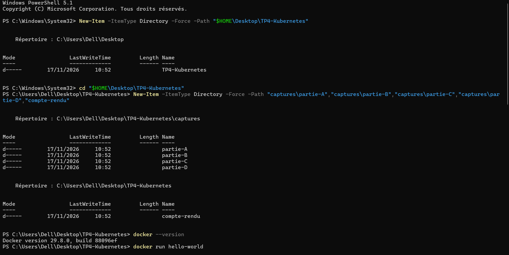

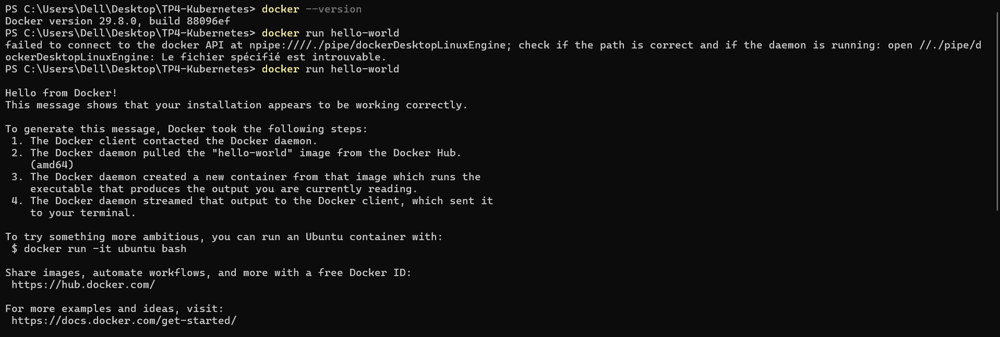

Versions des outils (`kind version`, `docker --version`, `kubectl version --client`, `helm version`) et `docker info` :

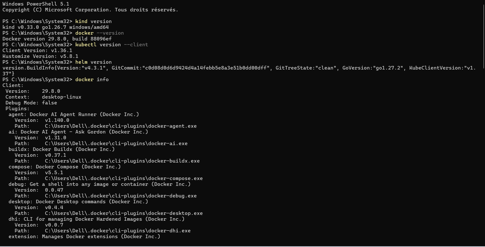

## Partie A : créer le cluster

`kind-config.yaml` (1 control-plane, 2 workers, port 30080 ouvert sur l'hôte) :

```yaml
kind: Cluster
apiVersion: kind.x-k8s.io/v1alpha4
name: tp-k8s
nodes:
  - role: control-plane
    extraPortMappings:
      - containerPort: 30080
        hostPort: 30080
  - role: worker
  - role: worker
```

```powershell
kind create cluster --config kind-config.yaml
kubectl get nodes -o wide
kubectl get pods -n kube-system
docker ps
```

`kubectl get nodes -o wide` : trois nœuds (`tp-k8s-control-plane`, `tp-k8s-worker`, `tp-k8s-worker2`), Kubernetes v1.37.0, runtime `containerd`. La capture a été prise quelques secondes après la création, d'où le statut `NotReady` transitoire :

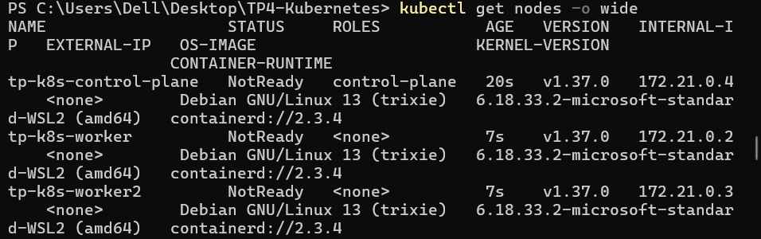

Chaque nœud Kubernetes est un conteneur Docker (`docker ps` : image `kindest/node`), et le port 30080 de l'hôte est redirigé vers le control-plane. Le rôle des Pods de `kube-system` est détaillé à la question 1.

## Partie B : le Pod

```powershell
kubectl run web --image=nginx:1.27 --port=80
kubectl get pods -o wide
kubectl describe pod web
kubectl logs web
kubectl exec -it web -- sh
kubectl port-forward pod/web 8080:80
kubectl delete pod web
```

Premier essai : le Pod `web` est planifié sur `tp-k8s-worker` mais reste en `ContainerCreating`, car l'image ne peut pas être téléchargée (problème DNS décrit plus haut). `kubectl logs` renvoie `container "web" is waiting to start`.

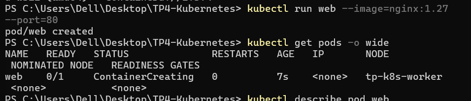

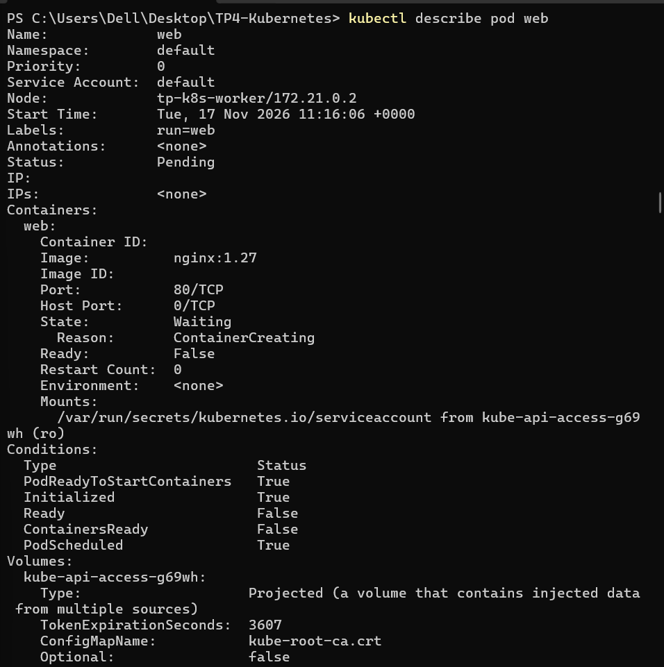

Après chargement de l'image dans les nœuds, le Pod est recréé et passe en `Running` (IP `10.244.2.3`, nœud `tp-k8s-worker`). Les événements indiquent `Container image "nginx:1.27" already present on machine`, ce qui confirme l'utilisation de l'image chargée :

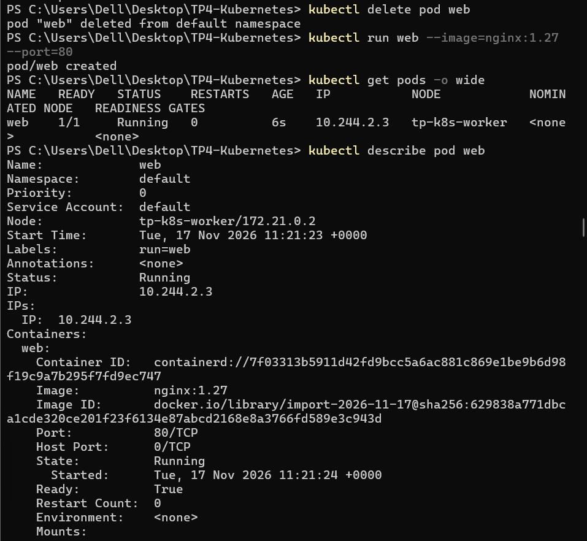

`kubectl logs web` affiche le démarrage de nginx, et `kubectl exec -it web -- sh` ouvre un shell dans le conteneur. Avec `kubectl port-forward pod/web 8080:80`, la page d'accueil de nginx est servie sur `http://localhost:8080`.

Suppression du Pod (`kubectl delete pod web`) : `kubectl get pods` renvoie ensuite `No resources found in default namespace.` Le Pod n'est pas recréé.

Passage au déclaratif : `kubectl run web --image=nginx:1.27 --dry-run=client -o yaml > pod.yaml` génère le manifeste (`apiVersion`, `kind: Pod`, `metadata` avec le label `run: web`, `spec.containers`), puis `kubectl apply -f pod.yaml` crée le Pod à partir du fichier (voir `pod.yaml` dans le dépôt).

## Partie C : Deployment et Service

`whoami.yaml` :

```yaml
apiVersion: apps/v1
kind: Deployment
metadata:
  name: whoami
spec:
  replicas: 3
  selector:
    matchLabels:
      app: whoami
  template:
    metadata:
      labels:
        app: whoami
    spec:
      containers:
        - name: whoami
          image: traefik/whoami:v1.10
          ports:
            - containerPort: 80
---
apiVersion: v1
kind: Service
metadata:
  name: whoami
spec:
  type: NodePort
  selector:
    app: whoami
  ports:
    - port: 80
      targetPort: 80
      nodePort: 30080
```

`kubectl apply -f whoami.yaml` puis `kubectl get deploy,rs,pods,svc -o wide` : Deployment `3/3`, un ReplicaSet (`whoami-57487f77f`), trois Pods répartis sur les deux workers, Service `whoami` en NodePort `80:30080`.

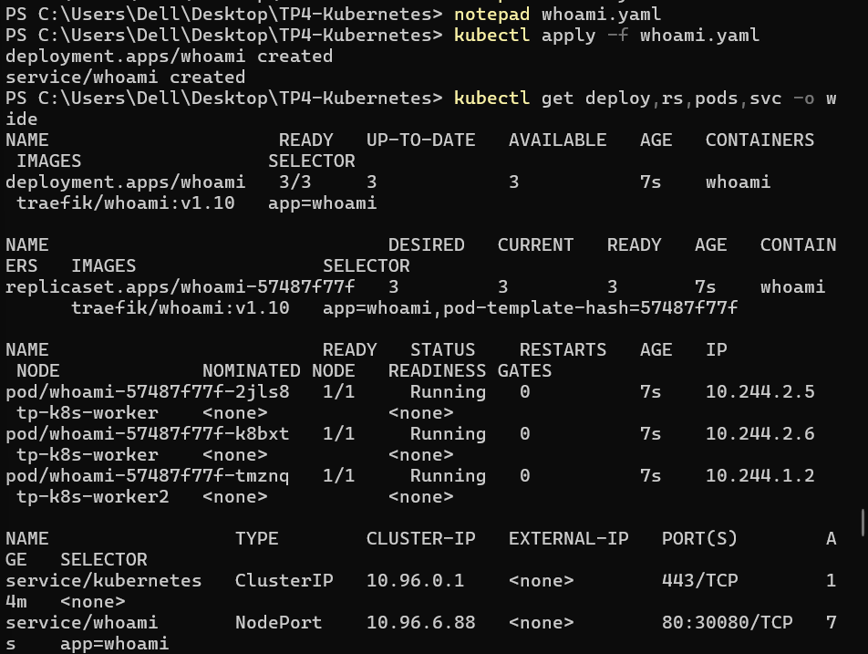

Quinze requêtes `curl` sur `http://localhost:30080` : le `Hostname` change, les trois Pods répondent (8, 4 et 3 réponses). La répartition est aléatoire par connexion, pas un tourniquet strict.

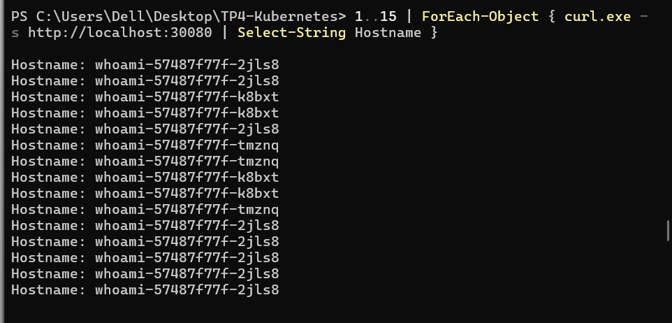

Auto-réparation : après `kubectl delete pod whoami-57487f77f-k8bxt`, un nouveau Pod (`whoami-57487f77f-9cqwh`) apparaît en quelques secondes et il y a toujours trois Pods. Puis `kubectl scale deployment whoami --replicas=6` : six Pods, trois sur chaque worker.

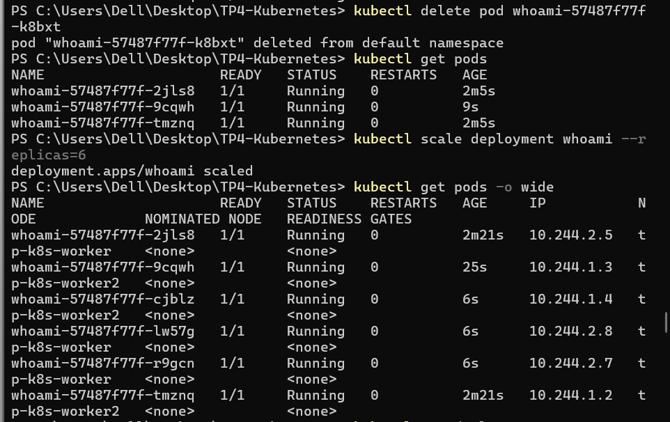

`kubectl get endpointslices` et `kubectl describe svc whoami` : le Service sélectionne les Pods par `app=whoami`, et l'EndpointSlice `whoami-fqtcn` liste leurs adresses (`10.244.1.2`, `10.244.2.5`, `10.244.1.3` et trois autres).

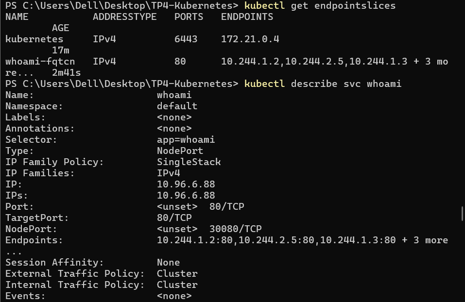

## Partie D : rolling update et rollback

Boucle `curl` lancée dans un second terminal pendant les opérations (`while ($true) { curl.exe -s localhost:30080 | Select-String Hostname; Start-Sleep -Milliseconds 500 }`). Les réponses passent progressivement des Pods `whoami-57487f77f-*` (v1.10) aux Pods `whoami-c66799bf6-*` (v1.11), sans interruption.

Mise à jour vers `v1.11` (`kubectl set image deployment/whoami whoami=traefik/whoami:v1.11`), puis `rollout status`, `get rs` (ancien ReplicaSet à 0, nouveau à 6) et `rollout history` (révisions 1 et 2). Ensuite, mise à jour vers l'image inexistante `v9.99` : trois nouveaux Pods `whoami-86d567c94d-*` apparaissent, pendant que les Pods `whoami-c66799bf6-*` restent en `Running`.

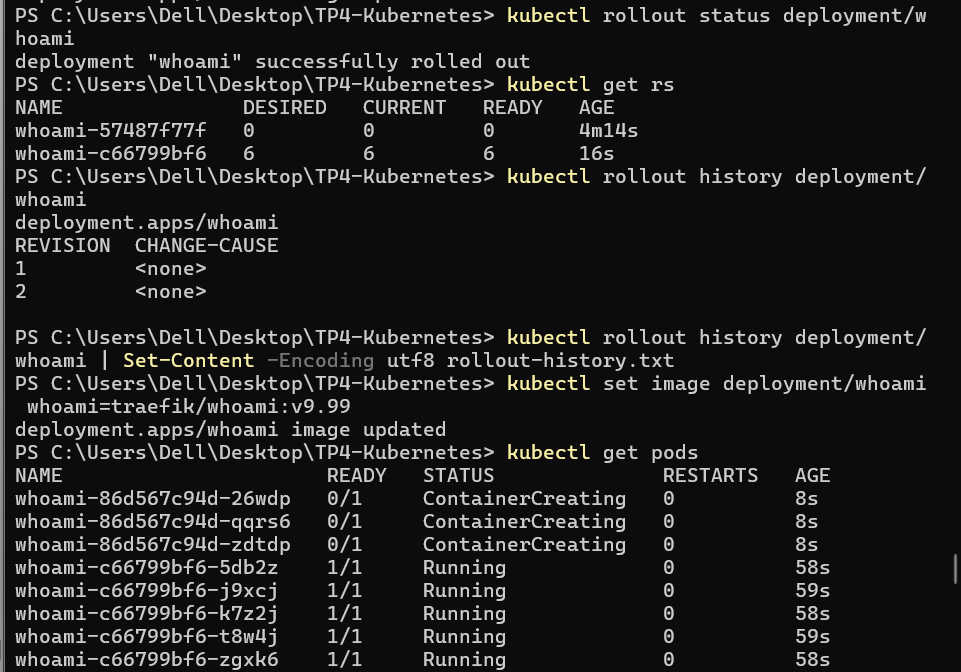

Les nouveaux Pods ne démarrent pas (capturés en `ContainerCreating`, le téléchargement de `v9.99` étant impossible). Comme pour `nginx:1.27` en partie B, un Pod dont l'image ne peut pas être téléchargée finit en `ErrImagePull` puis `ImagePullBackOff`.

`kubectl rollout status --timeout=30s` échoue (`3 out of 6 new replicas have been updated`, `timed out`) : le rollout est bloqué. Puis `kubectl rollout undo deployment/whoami` (retour à `v1.11`), `rollout status` (`successfully rolled out`), `get rs` (trois ReplicaSets, un seul actif) et `get pods` (les Pods cassés en `Terminating`) :

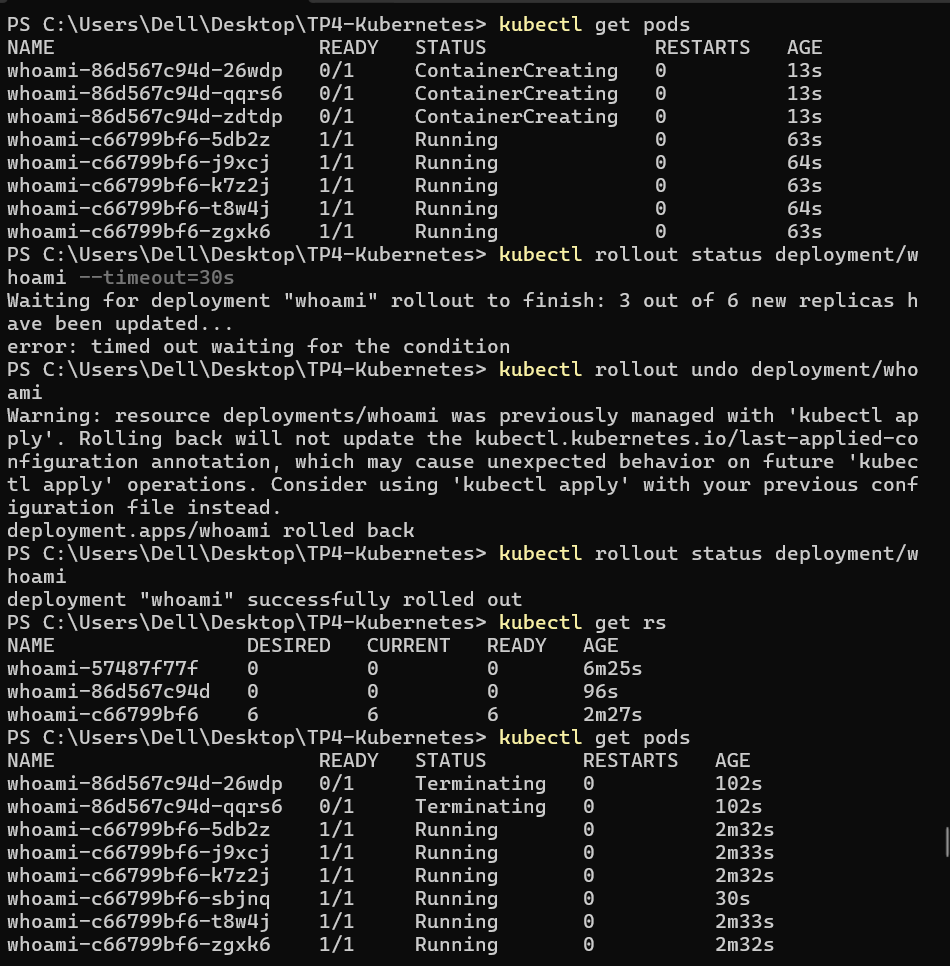

Historique final (révisions 1, 3 et 4) et `kubectl describe deployment whoami` (`RollingUpdateStrategy: 25% max unavailable, 25% max surge`, image `traefik/whoami:v1.11`, 6/6 réplicas) :

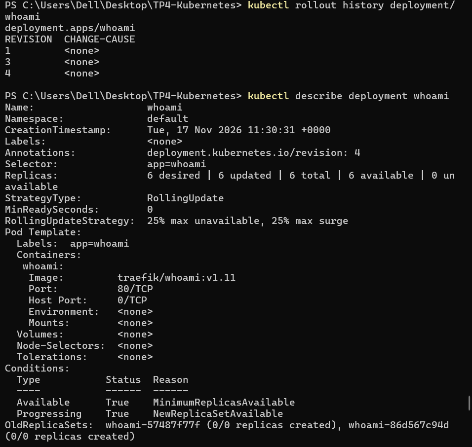

Événements du Deployment (montée du nouveau ReplicaSet et descente de l'ancien par paliers) :

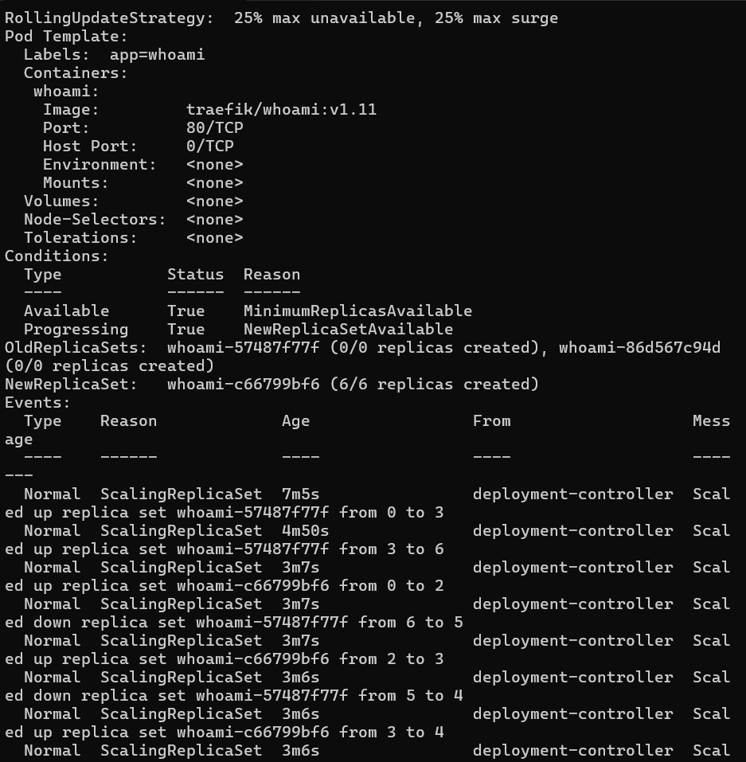

La sortie de `kubectl rollout history` est aussi enregistrée dans [`rollout-history.txt`](../rollout-history.txt).

## Questions

### 1. Rôle de chaque Pod de `kube-system`

| Pod | Rôle |
|---|---|
| `etcd` | Base clé-valeur distribuée qui stocke tout l'état du cluster (objets, configuration). Seul `kube-apiserver` y accède. |
| `kube-apiserver` | Point d'entrée de l'API Kubernetes. Authentifie et valide les requêtes (`kubectl`, kubelets, contrôleurs), puis lit et écrit l'état dans etcd. |
| `kube-scheduler` | Choisit le nœud de chaque Pod non planifié selon les ressources disponibles et les contraintes (affinités, taints). |
| `kube-controller-manager` | Exécute les boucles de contrôle (Deployment, ReplicaSet, Node, EndpointSlice...) qui comparent l'état désiré à l'état réel et corrigent l'écart. |
| `kube-proxy` | Présent sur chaque nœud. Programme les règles réseau (iptables, ipvs ou nftables) qui implémentent les Services (ClusterIP, NodePort) et répartissent le trafic entre les Pods. |
| `CoreDNS` | Serveur DNS du cluster (`10.96.0.10`). Résout les noms de Services, par exemple `whoami.default.svc.cluster.local`. Deux réplicas pour la disponibilité. |
| `kindnet` | Plugin réseau (CNI) de kind. Donne une IP à chaque Pod (`10.244.x.x`) et assure la connectivité Pod à Pod entre les nœuds. Un Pod par nœud (DaemonSet). |

Les composants du control plane (`etcd`, `kube-apiserver`, `kube-scheduler`, `kube-controller-manager`) n'existent qu'en un exemplaire, sur le nœud control-plane. `kube-proxy` et `kindnet` existent en trois exemplaires (un par nœud), et `CoreDNS` en deux.

### 2. Pourquoi le Pod `web` n'est-il pas recréé ?

Le Pod `web` a été créé directement avec `kubectl run`, sans contrôleur. Quand on le supprime, aucun objet ne surveille son existence et `kubectl get pods` renvoie `No resources found`.

Les Pods du Deployment appartiennent à un ReplicaSet dont le contrôleur maintient en permanence le nombre de réplicas voulu. Constaté : après `kubectl delete pod whoami-57487f77f-k8bxt`, le Pod `whoami-57487f77f-9cqwh` est apparu quelques secondes plus tard et on est resté à trois Pods.

### 3. Deployment, ReplicaSet et Pod

Le Deployment gère des ReplicaSets, et chaque ReplicaSet gère des Pods :

```
Deployment (whoami)
 ├── ReplicaSet whoami-57487f77f  (v1.10)  0 Pod
 ├── ReplicaSet whoami-86d567c94d (v9.99)  0 Pod
 └── ReplicaSet whoami-c66799bf6  (v1.11)  6 Pods
```

Le Deployment décrit l'état voulu (image, nombre de réplicas, stratégie). Le ReplicaSet garantit que N Pods identiques existent. Le Pod est l'unité d'exécution. Chaque modification du template de Pod (ici l'image) crée un nouveau ReplicaSet, identifié par le `pod-template-hash` dans son nom.

**À la fin, il existe 3 ReplicaSets**, un par version du template appliquée (`v1.10`, `v9.99`, `v1.11`). Seul `whoami-c66799bf6` est actif (6/6). Les deux autres sont conservés à 0 réplica pour permettre le retour en arrière (limite `revisionHistoryLimit`, 10 par défaut).

Le `rollout undo` n'a pas créé de nouveau ReplicaSet : il a réutilisé `whoami-c66799bf6` (la révision précédente, `v1.11`) et l'a remonté à 6. L'historique est `1, 3, 4` : la révision 2 (`v1.11`) est devenue la révision 4 au retour en arrière.

### 4. Comment le Service trouve-t-il ses Pods ?

Le Service `whoami` a le sélecteur `app=whoami`. Le contrôleur EndpointSlice cherche les Pods ayant ce label et prêts (`Ready`), puis maintient un objet EndpointSlice (`whoami-fqtcn`) qui liste leurs `IP:port`. `kube-proxy` s'appuie sur cette liste pour envoyer le trafic aux Pods.

Après le passage à 6 réplicas, l'EndpointSlice contenait 6 adresses, identiques aux IP de `kubectl get pods -o wide` (`10.244.1.2`, `10.244.2.5`, `10.244.1.3`, `10.244.1.4`, `10.244.2.8`, `10.244.2.7`). La liste se met à jour toute seule quand un Pod apparaît ou disparaît. Seuls les Pods `Ready` y figurent, ce qui explique qu'un Pod cassé ne reçoit aucun trafic (question 5).

### 5. Disponibilité pendant l'image cassée

**Oui, l'application est restée disponible.** La stratégie du Deployment est `RollingUpdate` avec `25% max unavailable` et `25% max surge`. Avec 6 réplicas :

- `maxUnavailable` = 25 % de 6 = 1,5, arrondi à **1** : au moins **5 Pods** doivent rester `Ready` à tout moment.
- `maxSurge` = 25 % de 6 = 1,5, arrondi à **2** : au plus **8 Pods** au total pendant la mise à jour.

C'est exactement ce que montre la capture D2 : 5 Pods `Running` de l'ancienne version (`whoami-c66799bf6-*`) et 3 nouveaux Pods (`whoami-86d567c94d-*`) qui ne démarrent pas, soit 8 Pods au total. Les nouveaux Pods n'atteignent jamais l'état `Ready`, donc le Deployment ne peut pas réduire l'ancien ReplicaSet sous le seuil de 5 Pods `Ready` : le rollout reste bloqué (`3 out of 6 new replicas have been updated`, puis `timed out`). Les 5 Pods sains continuent de servir le trafic, et les Pods non `Ready` sont retirés des endpoints du Service. Un `kubectl rollout undo` rétablit ensuite l'état sain.

## Défi : joindre le Service par son nom DNS complet

Depuis un Pod temporaire (`kubectl run test --rm -it --image=busybox:1.36 -- sh`) :

```
/ # nslookup whoami.default.svc.cluster.local
Server:   10.96.0.10
Address:  10.96.0.10:53
Name:     whoami.default.svc.cluster.local
Address:  10.96.6.88

/ # wget -qO- whoami.default.svc.cluster.local
Hostname: whoami-c66799bf6-zgxk6
...
```

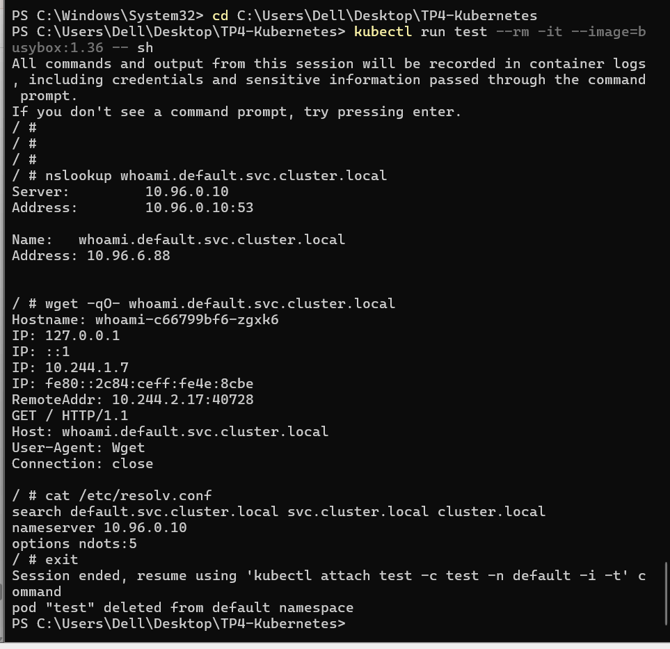

Le nom se lit de gauche à droite, du plus précis au plus général :

| Partie | Signification |
|---|---|
| `whoami` | Nom du Service. |
| `default` | Namespace dans lequel se trouve le Service. |
| `svc` | Type d'objet : un Service (les Pods ont `pod` à cet endroit). |
| `cluster.local` | Domaine DNS du cluster (valeur par défaut). |

`nslookup` renvoie `10.96.6.88`, la ClusterIP du Service, via CoreDNS (`10.96.0.10`). La requête `wget` a été répartie vers un Pod (`whoami-c66799bf6-zgxk6`).

Le `/etc/resolv.conf` du Pod contient `search default.svc.cluster.local svc.cluster.local cluster.local`, `nameserver 10.96.0.10` et `options ndots:5`. Grâce à ces domaines de recherche, depuis le namespace `default`, le nom court `whoami` suffit. Depuis un autre namespace, il faut au moins `whoami.default`.

## Fichiers du dépôt

- `kind-config.yaml` : configuration du cluster
- `whoami.yaml` : Deployment et Service
- `pod.yaml` : Pod déclaratif (partie B)
- `rollout-history.txt` : sortie de `kubectl rollout history`
- `compte-rendu/compte-rendu.md` : ce document
- `captures/` : captures d'écran par partie
